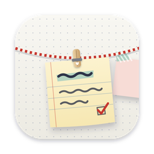
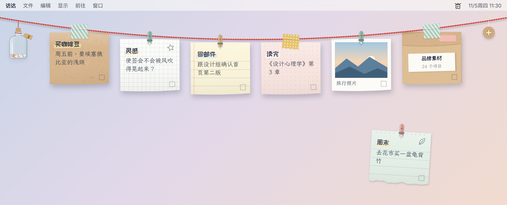
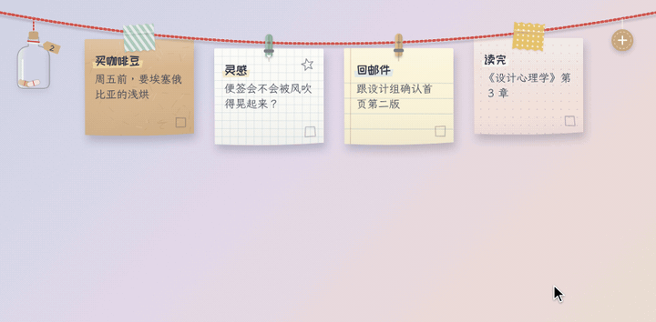
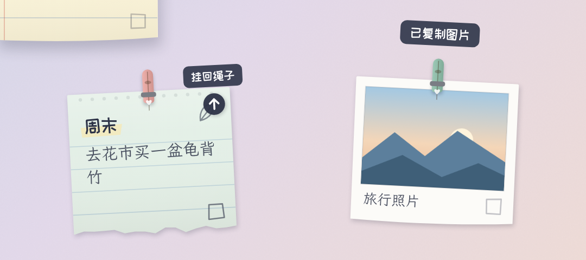
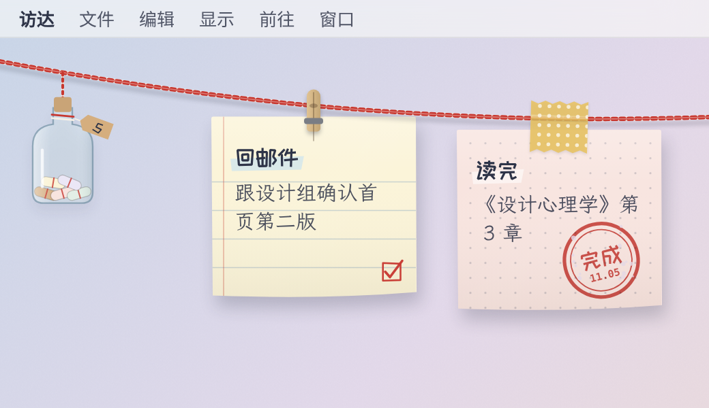
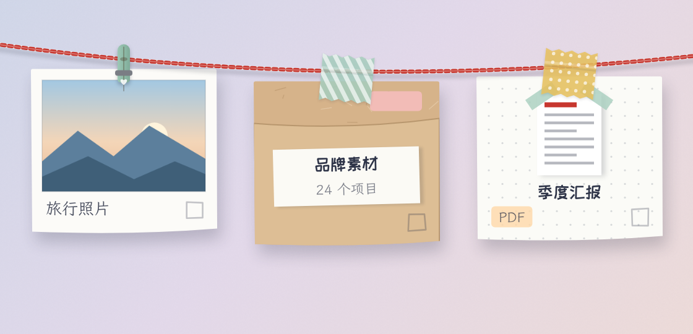
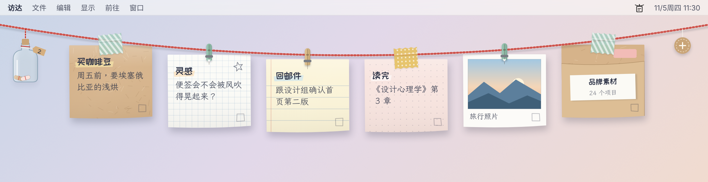
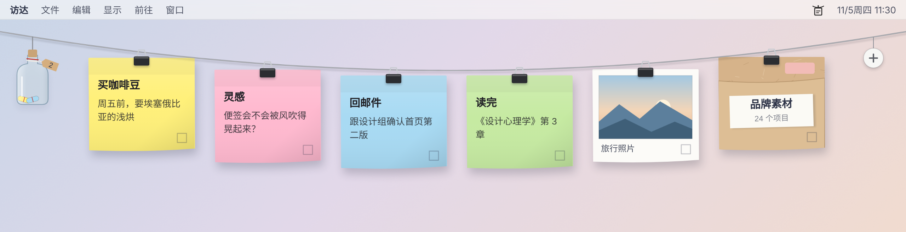
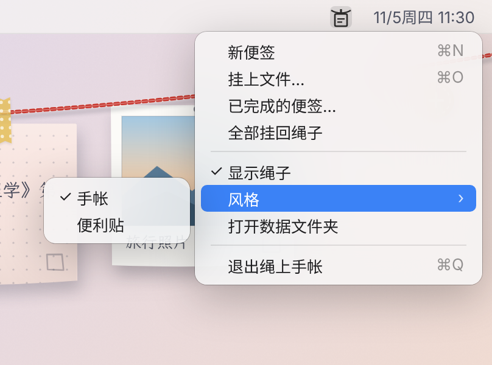

<p align="center">
  
</p>

<h1 align="center">绳上手帐</h1>

<p align="center"><b>把便签、图片和文件夹，用小夹子挂在桌面顶端的一根绳子上。</b><br>
macOS 菜单栏应用 · 手帐 / 便利贴两种风格 · 数据只存在本机</p>

<p align="center">
  <a href="https://github.com/yujiayan1016/string-journal/releases/latest"><b>⬇︎ 下载最新版</b></a>
</p>



> 本页图片是按应用的绘制方式生成的示意图，用来说明功能，和真机效果基本一致。

---

## 它是什么

一根横在屏幕顶端的绳子，上面挂着你的便签。它始终待在**桌面这一层**：在壁纸和桌面图标之上、所有打开的软件之下，不会挡住任何窗口。把窗口挪开或者显示桌面时，一眼就能看到。

- **随手记**：点一下 ＋，写下要做的事。
- **拿得起放得下**：便签可以从绳子上取下来，丢在桌面任意位置，再一键挂回去。
- **不只是文字**：图片、文件夹、PDF 也能挂上去，双击就能打开。
- **做完就收起来**：勾一下，便签盖个「完成」章，自己飞进左边的漂流瓶。



---

## 下载安装

1. 打开 [最新版本页面](https://github.com/yujiayan1016/string-journal/releases/latest)，下载 `StringJournal-版本号.zip`。
2. 解压，把 **绳上手帐.app** 拖进「应用程序」文件夹。
3. 第一次打开时，macOS 会提示「无法验证开发者」（这个应用没有付费的苹果开发者签名）。放行方法任选一种：
   - 打开 **系统设置 → 隐私与安全性**，往下拉，点 **「仍要打开」**；
   - 或者在终端运行：
     ```bash
     xattr -dr com.apple.quarantine "/Applications/绳上手帐.app"
     ```
4. 打开后，屏幕顶端会出现绳子和 4 张使用说明便签，菜单栏右侧多出一个小图标。

需要 **macOS 13 Ventura** 或更新版本，Apple 芯片和 Intel 芯片都支持。

**升级**：先在菜单栏图标里选「退出绳上手帐」，再用新版替换旧版，便签不会丢。

---

## 怎么用

### 1. 新建和编辑便签

| 操作 | 方法 |
| --- | --- |
| 新建 | 点绳子右端的 **＋**，或菜单栏图标 → 新便签（⌘N） |
| 编辑 | **双击**便签。第一行是标题，下面是正文 |
| 保存 | ⌘↩，或者直接点别处，会自动保存 |
| 取消 | Esc |

### 2. 取下来、挂回去

- **取下来**：按住便签往下拖，松手它就落在桌面上，可以随意摆放。快速一甩，它会滑一段再停下。
- **拖回绳子**：把便签拖到绳子附近，出现虚线空位时松手，两边的便签会自动让位。
- **一键挂回**：鼠标移到桌面上的便签，右上角会出现 **↑** 按钮，点一下它就飞回绳子；右键菜单里也有「挂回绳子」。
- **全部挂回**：菜单栏图标 →「全部挂回绳子」，一次把桌面上的都收回去。



### 3. 完成：盖章，放进漂流瓶

做完的事有三种收法，效果一样：

| 方法 | 操作 |
| --- | --- |
| 勾选 | 点便签右下角的小方框，盖上「完成」章，1 秒后便签自己飞进漂流瓶 |
| 拖进去 | 把便签拖到绳子左端的漂流瓶上，松手 |
| 甩出去 | 取下便签后用力往屏幕边缘一甩，它会揉成纸团飞走 |



- 完成后左上方会出现「撤销」，**4.5 秒内**点它可以反悔。
- 点漂流瓶会展开已完成列表，可以「挂回」或删除。
- 漂流瓶**每天自动清空，重启应用也会清空**。

### 4. 挂图片、文件和文件夹



| 怎么挂上去 | 说明 |
| --- | --- |
| 拖到绳子上 | 从访达或桌面把文件拖到绳子附近，出现虚线空位时松手 |
| 拖到菜单栏图标上 | 绳子被窗口挡住时最方便，图标会高亮，松手即挂上 |
| 菜单「挂上文件…」 | ⌘O，在弹出的窗口里选择，可以多选 |

一次最多挂 8 个。挂上去的样子：

- **图片** → 拍立得，显示缩略图和文件名；
- **文件夹** → 牛皮纸档案袋，写着名字和里面有几个项目；
- **其他文件** → 带系统快速预览缩略图的卡片，标出类型（PDF、KEY、FIG……）。

挂上去以后：

- **双击**打开；
- **右键**：打开、**复制图片**（图片专有，可以直接粘贴到微信、Figma、Keynote 等）、复制文件、在访达中显示、挂回绳子、完成。

> **挂上去的只是快捷方式**，原文件留在原处不动。原文件移动或改名后也能找到；把它从绳子上取下、丢进漂流瓶，都不会影响原文件。如果原文件被删了，卡片上会显示「找不到原文件」。

### 5. 两种风格

菜单栏图标 → **风格**，随时切换，便签内容不变。

**手帐**：红白面包师绳、小木夹和纸胶带，牛皮纸、方格纸、横线纸、撕页，荧光笔标题配手写字。



**便利贴**：细灰绳和黑色长尾夹，六种经典纯色便利贴，系统字体，干净好认。



### 6. 菜单栏

点菜单栏右侧的绳上手帐图标：



| 菜单项 | 作用 |
| --- | --- |
| 新便签 ⌘N | 在绳子上新建一张，并打开编辑 |
| 挂上文件… ⌘O | 选择文件或文件夹挂到绳子上 |
| 已完成的便签… | 打开漂流瓶里的列表 |
| 全部挂回绳子 | 把桌面上所有便签收回绳子 |
| 显示绳子 | 取消勾选后，绳子、漂流瓶和 ＋ 一起隐藏，便签落在桌面上随意摆放；再勾选，原来挂着的会回到原位 |
| 风格 | 手帐 / 便利贴 |
| 打开数据文件夹 | 在访达中显示便签数据文件 |

---

## 常见问题

**便签会挡住我正在用的软件吗？**
不会。它固定在桌面这一层，所有窗口都在它上面。

**便签被窗口挡住了，点不到怎么办？**
把窗口挪开，或者用触控板手势（拇指和三指张开）、触发角来显示桌面。挂文件时，也可以直接拖到菜单栏图标上。

**数据存在哪里？会上传吗？**
只存在本机：`~/Library/Application Support/StringJournal/notes.json`，旁边的 `notes.bak.json` 是上一次的备份。不联网，也不需要账号。

**漂流瓶里的东西找不回来了？**
漂流瓶每天和每次重启都会清空，清空后就无法找回。需要保留的便签，请在清空前点「挂回」。

**怎么开机自动启动？**
系统设置 → 通用 → 登录项，点 ＋ 添加「绳上手帐」。

**怎么卸载？**
菜单栏图标里选「退出绳上手帐」，把应用拖进废纸篓；如果要连数据一起删，再删除上面那个数据文件夹。

---

## 从源码构建

需要 macOS 13+ 和 Xcode 命令行工具（不需要完整的 Xcode）：

```bash
xcode-select --install     # 只需一次
./build.sh                 # 为当前这台 Mac 构建
open "build/绳上手帐.app"
```

`UNIVERSAL=1 ./build.sh` 同时构建 Apple 芯片和 Intel 版本。每次推送到 `main`，GitHub Actions 都会在 macOS 上自动构建，并更新 [Releases](https://github.com/yujiayan1016/string-journal/releases) 里的下载包。

### 调整手感

所有手感参数都在 [`Sources/Tuning.swift`](Sources/Tuning.swift)，改完重新构建即可：

| 参数 | 值 | 含义 |
| --- | --- | --- |
| slack | 0 | 绳子松弛度，0 表示绷直 |
| stiff | 0.96 | 绳子刚度，越低越像橡皮筋 |
| ropeDamp | 0.06 | 绳子晃动消失的快慢 |
| gravity | 400 | 影响摆动快慢 |
| cardMass | 1.5 | 便签相对绳子的重量 |
| swingDamp | 4.7 | 便签停下来的快慢 |
| coupling | 0.18 | 便签摆动对绳子的牵连 |
| follow | 24 | 拖拽跟手程度，越低越有滞后感 |
| brush / brushCap | 0.1 / 0.12 | 鼠标扫过便签时的推力和上限 |
| nudge | 0.5 | 点击、新建、盖章时的晃动 |
| friction | 4 | 便签在桌面上滑行的摩擦 |

### 目录

```
Sources/
  main.swift      菜单栏图标与菜单
  Overlay.swift   桌面层透明窗口、点击穿透、主循环、拖放、保存
  World.swift     绳子与便签的物理、拖拽、挂回、完成、漂流瓶
  Render.swift    绘制：手帐与便利贴两种风格
  Files.swift     文件快捷方式：分类、书签、缩略图、打开、复制
  Panels.swift    编辑框与「已完成」列表
  Model.swift     风格、便签样式、数据存储
  Tuning.swift    手感参数
Resources/
  Fonts/          霞鹜文楷 TC、站酷快乐体（已裁剪为常用字）
  AppIcon.svg     应用图标源文件
docs/images/      本说明里的示意图
```

## 致谢

- 绳子挂便签的创意来自 [String Notes](https://github.com/TD21forever/string-notes)（MIT），本项目代码为独立实现。
- 字体：[霞鹜文楷 TC](https://github.com/lxgw/LxgwWenkaiTC)、[站酷快乐体](https://fonts.google.com/specimen/ZCOOL+KuaiLe)，均为 SIL Open Font License，许可证见 `Resources/Fonts/`。
